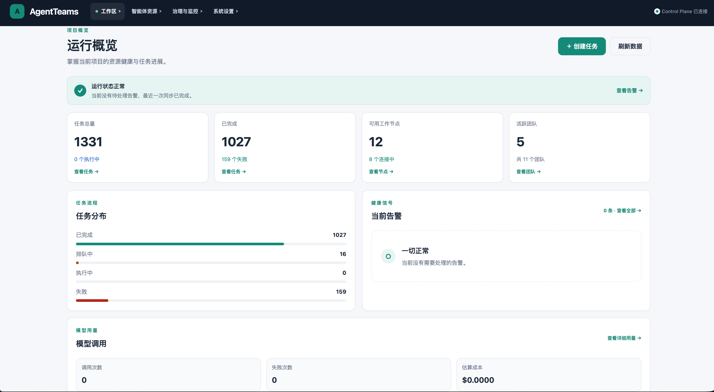
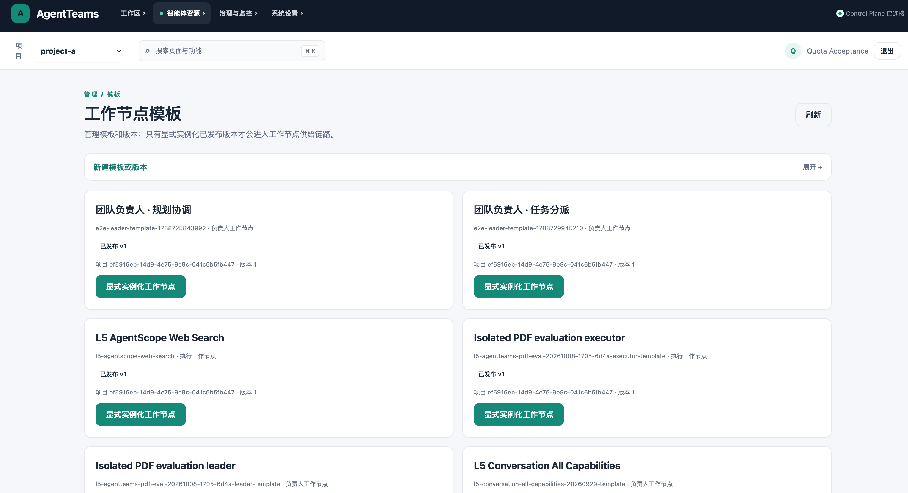
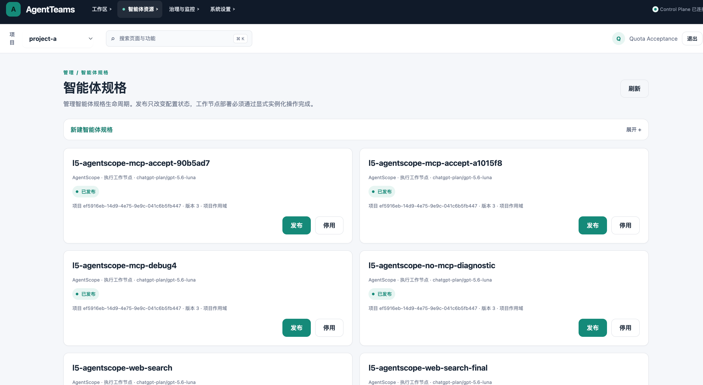
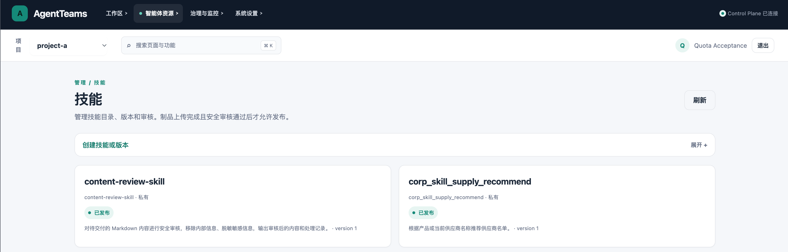
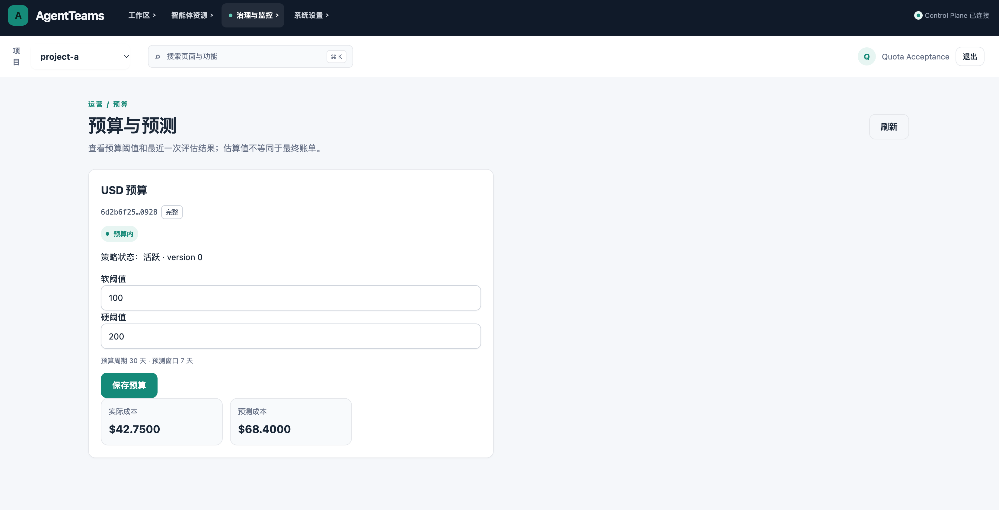
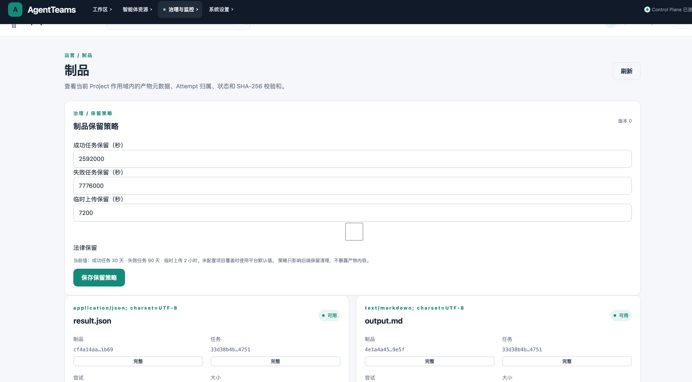
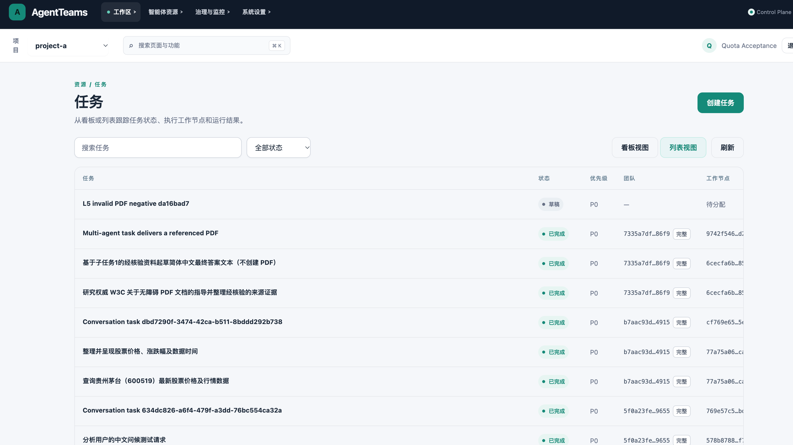
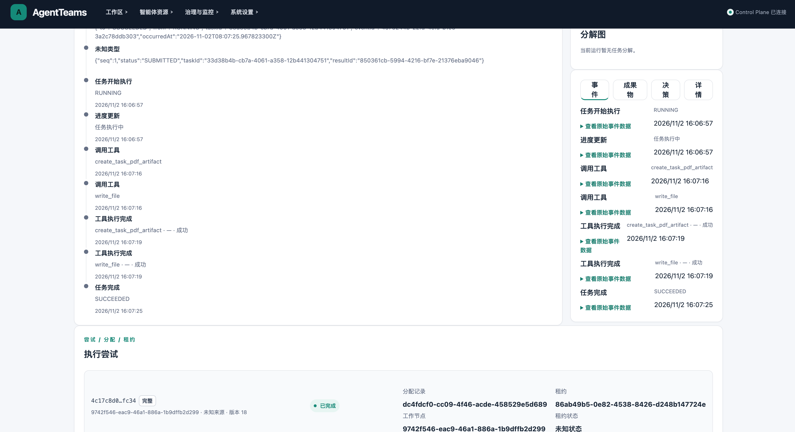

# AgentTeams Java

AgentTeams Java 是基于 Java 21 与 Kubernetes 的多 Agent 任务协作平台。它将任务创建、团队调度、Worker 执行、过程事件和结果交付串成一条可追踪的链路，并提供管理 Console、公共 API 和 SDK。

> 项目仍在持续开发。下文区分已实现能力、环境验证和需要额外基础设施的能力；L5 是项目的集成验收环境，并非生产环境。

**快速入口：** [历史任务回放](#历史任务回放) · [L5 页面截图](#l5-环境页面) · [架构图](docs/architecture-map.html) · [运行与验证](#技术栈与运行)

## 先看项目

**典型流程：** 用户通过 Console 或 API 创建任务 → Control Plane 持久化任务并通过 Outbox 发布事件 → NATS JetStream 传递调度消息 → Gateway 经 gRPC 流将任务送达 Worker → Worker 回报进度与结果 → Console 展示执行过程和交付物。

| 能力 | 实现入口 | 解决的问题 |
| --- | --- | --- |
| 可靠任务分发 | `control-plane`、`agent-gateway` | 将任务状态、消息投递和 Worker 执行衔接起来 |
| 多 Agent 协作 | `manager`、`agent-worker` | 管理任务分工、执行和结果回传 |
| Kubernetes 运行治理 | `operator`、`deploy/helm` | 管理 Worker 和可选的任务级隔离资源 |
| 管理与集成 | `console`、`openapi`、`sdk` | 提供可视化操作与公共 API |

### L5 环境页面

以下是 L5 集成验收环境的 Console 实际页面。页面数据为环境当时的快照，不代表生产运行指标。

| 运行概览 | 工作节点模板 |
| --- | --- |
|  |  |
| 汇总任务状态、可用节点和团队数量。 | 展示模板发布与工作节点实例化入口。 |

展开更多 L5 页面：智能体规格、技能、预算与制品

| 智能体规格 | 技能目录 |
| --- | --- |
|  |  |
| 展示 Agent 规格和发布状态。 | 展示技能版本与发布状态。 |

| 预算与预测 | 制品管理 |
| --- | --- |
|  |  |
| 展示预算阈值、实际成本与预测成本。 | 展示任务制品元数据和保留策略。 |

**评测记录：** [查看 L5 评测页面截图](docs/screenshots/l5/evaluations.png)。页面同时展示通过和失败的评测运行，便于查看质量验证的实际状态；单次运行的结论须以对应评测报告为准。

**治理与质量：** [角色与权限](docs/screenshots/l5/roles-permissions.png)展示平台、组织及项目成员授权入口；[成果物质量优化台账](docs/screenshots/l5/artifact-quality-ledger.png)展示来源引用、PDF 和成果物质量检查的历史记录。台账包含未通过及结论未知的记录，不能据此宣称所有成果物均已通过检查。

### 历史任务回放

[观看 L5 Console 历史任务回放（MP4）](docs/demo/l5-historical-task-replay.mp4)。这段视频回放 2026-11-02 的一条已完成任务，展示任务列表、状态与执行事件、子任务依赖和结果页面；它不是本轮新建任务的实时录屏。

| 任务列表 | 执行事件 |
| --- | --- |
|  |  |
| 从列表查看任务状态与所属团队。 | 查看 Worker 执行、工具调用和任务终态。 |

该历史任务的标题提到 PDF，当前父任务成果物列表实际仅显示可下载的 `output.md`。因此它用于展示调度与执行过程，不作为 PDF 成功交付的证据。详细记录见[演示素材说明](docs/demo/README.md)。

### 架构与验证入口

- [架构图与代码地图](docs/architecture-map.html)：模块职责、依赖关系、核心数据流和部署拓扑。
- [公开 API 契约](openapi/agentteams-public.yaml)：任务与项目接口、鉴权、幂等和错误结构。
- [集成评测说明](eval/README.md)：评测方法与报告入口；具体结果以对应报告为准。
- [生产部署说明](deploy/production/README.md)：部署前提与运维说明。

## 技术栈与运行

- Java 21、Spring Boot 3、Maven 多模块；PostgreSQL 与 Flyway 管理业务数据。
- NATS JetStream 承载事件，gRPC 双向流连接 Gateway 与 Worker。
- Kubernetes Operator 和 Helm 管理集群资源；Console 提供操作界面。

本地构建需要 JDK 21。单元测试使用 `mvn -q test`；依赖 Docker 的集成验证使用 `mvn -q -Pintegration-tests verify`。完整的环境准备、部署方式及限制见 [技术参考](README-technical.md) 与 [生产部署说明](deploy/production/README.md)。

## 项目状态

仓库展示的是持续开发中的平台与 L5 集成验收环境。截图仅证明对应页面在该环境可见；功能行为与质量结论请结合代码、测试和[评测说明](eval/README.md)核对。需要真实模型、外部 Secret Manager 或特定隔离运行时的场景，按各自验收文档确认边界。
